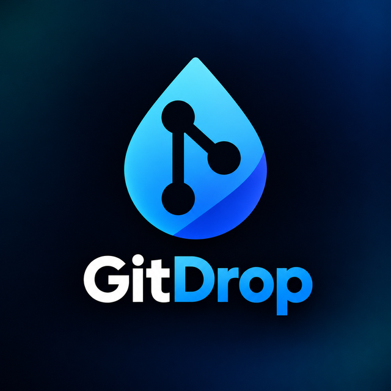

  

<h1 align="center">GitDrop</h1>

  🇬🇧 <a href="#english">English</a> |  🇮🇶 <a href="#arabic">العربية</a>

  
  
  
  

# 🇬🇧 GitDrop: upload files from your phone to GitHub

GitDrop is a free, open-source Android app that sends files and folders from your phone straight to a GitHub repository. You don't need a computer or any Git commands: connect, choose where the files should go, pick what to send, and tap upload.

---

## How does it work?

1. **Connect.** Paste your GitHub access token. It is checked right away. Don't have one? Tap *Create a token on GitHub*.
2. **Choose the destination.** Pick a repository and a branch, or create a new branch.
3. **Select your files.** Add files or whole folders, or share them to GitDrop from another app. You can also type a folder inside the repository and a commit message.
4. **Review and upload.** See what is new, what changed and what is already there, read any warnings, then tap upload.

---

## What can it do?

- **Upload files and whole folders:** everything inside a folder is ticked by default, so just untick what you don't want. The folder structure is kept, and you can choose a destination folder inside the repository.
- **Review before you upload:** every file is marked new, changed or same, so you know exactly what will happen. Nothing changes on GitHub until you confirm.
- **Secret check:** passwords, keys and `.env` files are spotted on your phone before anything is sent, and they start unticked.
- **Wrong-project warning:** if an Android project you upload looks different from the one already in the repository, GitDrop warns you.
- **New branch from the app:** create a branch without leaving GitDrop, for example when your main branch is protected.
- **Share to GitDrop:** pick *GitDrop* in the share sheet of Files, Gallery or any other app to add files to your selection.
- **Fast:** small files are sent together in a few commits instead of one request per file.
- **Safe to repeat:** files that are already in the repository with the same content are skipped, so an interrupted upload can simply be run again.
- **Works on empty repositories:** GitDrop creates the first commit for you.
- **Stop any time:** whatever was already uploaded stays in the repository.
- **Live progress:** current step, files done, speed and time left. If GitHub asks for a short break, GitDrop waits and continues by itself.
- **Checked result:** after the upload, GitDrop asks GitHub again and confirms that your files arrived.
- **10 languages, your choice:** English, Arabic, Persian, Russian, Spanish, French, German, Turkish, Chinese and Portuguese. Tap the language button on the first screen to switch at any time, or let the app follow your phone's language. Right-to-left languages are fully supported. After a switch, the app starts again from the first screen.

---

## Review before you upload

| Label | Meaning |
| --- | --- |
| **NEW** | This file is not in the branch yet. |
| **CHANGED** | The file exists with different content. Uploading replaces it. |
| **SAME** | The exact same file is already there. Nothing is uploaded for it. |

Use the filters (*All, New, Changed, Flagged*) and the tick boxes to decide what goes up.

**Flagged files** may contain a password, an API key, a private key, or a keystore. They start unticked, and *Select all* never ticks them. If you tick one on purpose, GitDrop asks you once more before uploading.

The secret check is a safety net, not a guarantee. It can miss something and it can flag harmless text, so you always stay in control. All of it runs on your phone.

---

## Requirements

- Android 7.0 or newer.
- A GitHub account and an access token: a *classic* token with the `repo` scope, or a *fine-grained* token with **Contents: Read and write** on the repository you want to upload to.

To get a token, tap **Create a token on GitHub** in the app. Or go to GitHub → Settings → Developer settings → Personal access tokens.

---

## Installation

1. Download the GitDrop APK file.
2. Open it on your phone. If Android asks, allow installing apps from this source.
3. Open GitDrop and follow the four steps above.

---

## Privacy and safety

- **Your token stays in memory.** It is never saved to the phone, never logged, and it is forgotten when you close the app. It is sent only to GitHub (`api.github.com`) over HTTPS.
- **Only your language choice is remembered.** GitDrop keeps nothing else about you on the phone.
- **Only one permission:** internet access. GitDrop can see only the files and folders you choose.
- **No tracking:** no account, no analytics, no ads.
- **Nothing is deleted.** GitDrop adds and updates files. It never deletes or renames files in your repository, and it never force-pushes.
- **Protected branches:** GitDrop doesn't try to get around them. If GitHub rejects a direct upload, choose another branch or create one with **New branch…**.
- **Shared files** are only added to your selection. Nothing is uploaded until you review and confirm.

---

## Limits

- Files over **95 MB** are skipped and listed in the result (GitHub does not accept files over 100 MiB).
- **Empty folders** are not uploaded, because Git does not store them.
- GitDrop is for uploading. It is not a full Git client: no clone, pull, delete or rename.

---

## Credits and License

- Author: Mushussu Babylon
- Released under the [MIT License](LICENSE). You are free to use, modify and share it, with credit to the source.

---

Made for everyone who wants to move files to GitHub from a phone. Enjoy!

  <a href="#languages">⬆ Back to language selection</a>

---

# 🇮🇶 GitDrop: ارفع ملفاتك من هاتفك إلى GitHub

GitDrop تطبيق أندرويد مجاني ومفتوح المصدر يرفع الملفات والمجلدات من هاتفك مباشرة إلى مستودع على GitHub. لا تحتاج إلى حاسوب ولا إلى أوامر Git: اتصل بحسابك، واختر وجهة الملفات، وحدّد ما تريد إرساله، ثم اضغط رفع.

---

## كيف يعمل؟

1. **الاتصال.** الصق رمز الوصول من GitHub، ويُتحقق منه فورا. ليس لديك رمز؟ اضغط «إنشاء رمز على GitHub».
2. **اختيار الوجهة.** اختر المستودع والفرع، أو أنشئ فرعا جديدا.
3. **تحديد الملفات.** أضف ملفات أو مجلدات كاملة، أو شاركها إلى GitDrop من تطبيق آخر. ويمكنك أيضا كتابة مجلد داخل المستودع ورسالة إيداع.
4. **المراجعة والرفع.** شاهد ما هو جديد وما تغيّر وما هو موجود أصلا، واقرأ أي تحذيرات، ثم اضغط رفع.

---

## ماذا يفعل التطبيق؟

- رفع الملفات والمجلدات الكاملة: كل شيء داخل المجلد يكون محددا افتراضيا، فأزل تحديد ما لا تريده فقط. تبقى بنية المجلدات كما هي، ويمكنك اختيار مجلد وجهة داخل المستودع.
- مراجعة قبل الرفع: يُعلَّم كل ملف بأنه جديد أو معدَّل أو مطابق، فتعرف بالضبط ما الذي سيحدث. ولا يتغير شيء على GitHub حتى تؤكد أنت.
- فحص الأسرار: تُكتشف كلمات المرور والمفاتيح وملفات `.env` على هاتفك قبل إرسال أي شيء، وتبدأ غير محددة.
- تنبيه المشروع الخاطئ: إذا بدا مشروع أندرويد ترفعه مختلفا عن المشروع الموجود في المستودع، ينبهك GitDrop.
- فرع جديد من داخل التطبيق: أنشئ فرعا دون مغادرة GitDrop، مثلا عندما يكون فرعك الرئيسي محميا.
- المشاركة إلى GitDrop: اختر *GitDrop* من قائمة المشاركة في تطبيق الملفات أو المعرض أو أي تطبيق آخر لإضافة الملفات إلى تحديدك.
- سريع: تُرسل الملفات الصغيرة معا في عدد قليل من الإيداعات بدلا من طلب لكل ملف.
- آمن عند التكرار: تُتخطّى الملفات الموجودة أصلا في المستودع بمحتوى مطابق، لذا يمكنك ببساطة إعادة تشغيل رفع انقطع.
- يعمل مع المستودعات الفارغة: ينشئ GitDrop أول إيداع لك.
- إيقاف في أي وقت: ما رُفع بالفعل يبقى في المستودع.
- تقدم مباشر: الخطوة الحالية وعدد الملفات والسرعة والوقت المتبقي. وإذا طلب GitHub استراحة قصيرة ينتظر GitDrop ويتابع من تلقاء نفسه.
- نتيجة موثّقة: بعد الرفع يسأل GitDrop موقع GitHub مرة أخرى ويؤكد وصول ملفاتك.
- عشر لغات باختيارك: العربية والإنجليزية والفارسية والروسية والإسبانية والفرنسية والألمانية والتركية والصينية والبرتغالية. اضغط زر اللغة في الشاشة الأولى لتبديلها في أي وقت، أو اترك التطبيق يتبع لغة هاتفك. وتُدعم اللغات التي تُكتب من اليمين إلى اليسار بالكامل. وبعد التبديل يبدأ التطبيق من الشاشة الأولى مجددا.

---

## المراجعة قبل الرفع

| العلامة | المعنى |
| --- | --- |
| **جديد** | هذا الملف غير موجود في الفرع بعد. |
| **معدَّل** | الملف موجود بمحتوى مختلف. سيحل الرفع محله. |
| **مطابق** | الملف نفسه موجود أصلا. لا يُرفع شيء له. |

استخدم المرشحات (*الكل، جديد، معدَّل، مُعلَّم*) ومربعات التحديد لتقرر ما يُرفع.

**الملفات المُعلَّمة** قد تحتوي على كلمة مرور أو مفتاح API أو مفتاح خاص أو ملف keystore. تبدأ غير محددة، ولا يحددها زر *تحديد الكل* أبدا. وإذا حددت أحدها عمدا فسيسألك GitDrop مرة أخرى قبل رفعه.

فحص الأسرار شبكة أمان وليس ضمانا: قد يفوته شيء، وقد يعلّم نصا غير ضار، لذلك يبقى القرار لك دائما. ويعمل كله على هاتفك.

---

## المتطلبات

- أندرويد 7.0 أو أحدث.
- حساب على GitHub ورمز وصول: رمز *كلاسيكي* بصلاحية `repo`، أو رمز *دقيق الصلاحيات (fine-grained)* بصلاحية **Contents: Read and write** على المستودع الذي تريد الرفع إليه.

للحصول على رمز، اضغط **إنشاء رمز على GitHub** في التطبيق. أو افتح GitHub ← Settings ← Developer settings ← Personal access tokens.

---

## طريقة التثبيت

1. حمّل ملف GitDrop بصيغة APK.
2. افتحه على هاتفك. وإذا طلب أندرويد ذلك، اسمح بتثبيت التطبيقات من هذا المصدر.
3. افتح GitDrop واتبع الخطوات الأربع أعلاه.

---

## الخصوصية والأمان

- **رمزك يبقى في الذاكرة فقط.** لا يُحفظ على الهاتف ولا يُسجَّل، ويُنسى عند إغلاق التطبيق. ولا يُرسل إلا إلى GitHub (`api.github.com`) عبر HTTPS.
- **يتذكر GitDrop اختيار اللغة فقط.** ولا يحتفظ بأي شيء آخر عنك على الهاتف.
- **صلاحية واحدة فقط:** الوصول إلى الإنترنت. ولا يرى GitDrop إلا الملفات والمجلدات التي تختارها.
- **بلا تتبع:** لا حساب ولا تحليلات ولا إعلانات.
- **لا شيء يُحذف.** يضيف GitDrop الملفات ويحدّثها فقط. لا يحذف ولا يعيد تسمية أي ملف في مستودعك، ولا يستخدم الرفع القسري (force push) أبدا.
- **الفروع المحمية:** لا يحاول GitDrop الالتفاف عليها. إذا رفض GitHub الرفع المباشر فاختر فرعا آخر أو أنشئ فرعا بزر **فرع جديد…**.
- **الملفات المشاركة** تُضاف إلى تحديدك فقط. ولا يُرفع شيء حتى تراجع وتؤكد.

---

## القيود

- الملفات التي تتجاوز **95 ميغابايت** تُتخطّى وتظهر في النتيجة (لا يقبل GitHub ملفات أكبر من 100 MiB).
- **المجلدات الفارغة** لا تُرفع، لأن Git لا يخزّنها.
- GitDrop مخصص للرفع. وليس عميل Git كاملا: لا استنساخ ولا سحب ولا حذف ولا إعادة تسمية.

---

## الشكر والترخيص

- المؤلف: Mushussu Babylon
- التطبيق: بموجب [رخصة MIT](LICENSE)، يمكنك استخدامه وتعديله وتوزيعه بحرية مع ذكر المصدر.

---

صُنع لكل من يريد نقل الملفات إلى GitHub من هاتفه. استمتعوا!

  <a href="#languages">⬆ العودة إلى اختيار اللغة</a>

