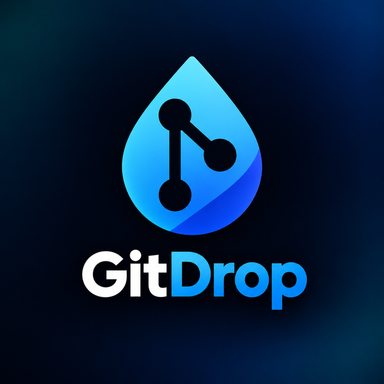

  

# GitDrop 🚀

**GitDrop** is a lightweight, open-source Android app that uploads files and folders from your phone straight to a GitHub repository. Paste a personal access token, pick a repository and branch, choose what to send, and tap upload. Everything is committed for you, in as few commits as possible.

---

## 📖 Overview

GitDrop is a four-step flow:

1. **Connect** — paste a GitHub personal access token (it is checked right away).
2. **Choose the destination** — pick one of the repositories your token can write to, and a branch (or create a new one).
3. **Select** — add files or whole folders, optionally choose a folder inside the repository. You can also *share* files to GitDrop from other apps.
4. **Review and upload** — see what is new, what changed and what is already up to date, get warned about passwords and keys, then upload exactly what you ticked.

---

## ✨ Key features

- **Review before you upload:** a checklist of every file marked *new*, *changed* or *same* (compared with the branch you picked), with sizes, filters and a tick box per file. See [Review before upload](#-review-before-upload).
- **Secret check:** passwords, tokens, private keys, `.env` files and keystores are spotted *on your phone* before anything leaves it, and start unticked.
- **Project check:** warns when an Android `applicationId` in your upload differs from the one in the repository (the "wrong repository" slip).
- **Verified result:** after the upload GitDrop asks GitHub again and confirms that the branch now points to your last commit.
- **New branch from the app:** create a branch (for example when `main` is protected) without leaving GitDrop.
- **Share to GitDrop:** pick *GitDrop* in any app's share sheet to add files to your selection.
- **Made for thumbs:** one primary button at the bottom of every screen, large touch targets, and a dark header that matches the logo.
- **Fast by design:** small files travel together — up to 100 files (6 MB) per commit in a single request — instead of one request per file. See [How the upload stays fast and safe](#-how-the-upload-stays-fast-and-safe).
- **Resumable:** files that are already in the repository with identical content are skipped, so an interrupted upload can simply be started again.
- **Works on empty repositories:** the first commit is created for you.
- **Stop at any time:** a *Stop upload* button ends the transfer cleanly; whatever was already committed stays in the repository.
- **Live progress:** current step, files and bytes done, transfer speed and an estimated time left.
- **Folder browser with checkboxes:** everything inside a picked folder is ticked by default — untick what you don't want, at any depth. `.git` folders are left out automatically.
- **Destination folder:** type a path inside the repository or browse the repository's folders. The folder structure of your selection is kept.
- **Repository filter:** a search box appears when your token can reach many repositories; the default branch is always listed first.
- **10 languages:** English, Arabic, Persian, Russian, Spanish, French, German, Turkish, Chinese and Portuguese (right-to-left layouts included).
- **Privacy first:** no account, no analytics, no tracking — see below.

---

## 🔍 Review before upload

Tapping **Review and upload** changes nothing on GitHub. GitDrop reads the branch (read-only requests), compares it with your selection and shows the result:

| Badge | Meaning |
| --- | --- |
| **NEW** | The path does not exist in the branch yet. |
| **CHANGED** | The path exists with different content; uploading replaces it. |
| **SAME** | Identical content is already there; nothing is uploaded for it. |
| *(none)* | The branch could not be compared (for example a huge repository). GitDrop still skips identical files during the upload. |

Use the filters (*All / New / Changed / Flagged*) and the tick boxes to decide what goes up. **Select all** never ticks flagged files — to include one you have to open the *Flagged* view, and GitDrop asks once more before uploading it.

**What the secret check looks for** (all of it locally, nothing is sent anywhere):

- file names such as `.env`, `*.jks`, `*.keystore`, `*.p12`, `id_rsa`, `keystore.properties`, service-account files (templates like `.env.example` are ignored);
- well-known token formats — GitHub, GitLab, AWS, Google, Slack, Stripe, OpenAI, Anthropic, SendGrid, npm, Hugging Face, Telegram and others;
- private-key blocks (`-----BEGIN … PRIVATE KEY-----`);
- passwords written into URLs and `password = "…"` style assignments (placeholders such as `YOUR_PASSWORD` or `${VAR}` are ignored).

It is a safety net, **not a guarantee**: it can miss a secret and it can flag harmless text, which is why you stay in control. It never shows the suspected secret itself, only the kind, the provider and the line number. Text files up to 2 MB are read; binary files are not.

---

## ⚡ How the upload stays fast and safe

GitHub limits how quickly an app may send requests. GitDrop is built to go as fast as those limits allow, and no faster:

| Situation | What GitDrop does |
| --- | --- |
| Many small files (up to 1 MB each) | Sends them in batches of up to **100 files / 6 MB** as **one commit per batch** through GitHub's GraphQL `createCommitOnBranch` mutation — a handful of requests instead of hundreds. |
| Larger files (up to 95 MB) | Uploads each file as a Git blob over the REST Git Data API, **two at a time**, then commits them in groups. |
| Write requests | At least **one second** between write requests, as GitHub's guidelines ask. |
| Files already in the repository | Compared by Git blob hash and **skipped** when identical — nothing is re-uploaded. |
| Rate limit or "slow down" reply | Honors `Retry-After` / `x-ratelimit-reset`, waits, and continues. If the wait would be unreasonably long it stops with a clear message; nothing is lost. |
| Someone else pushes to the branch meanwhile | GitDrop builds on the new branch head. It **never force-pushes**. |
| Flaky connection | Stalled or failed requests are retried with back-off; after an unclear failure the app checks whether the commit actually landed before trying again. |

Uploading a path that already exists replaces that file's content. GitDrop never deletes or renames files in your repository.

---

## 📋 Requirements

| Requirement | Details |
| --- | --- |
| **Android version** | Android 7.0 (API 24) or newer |
| **GitHub credentials** | A personal access token: a *classic* token with the `repo` scope, **or** a *fine-grained* token with **Contents: Read and write** on the target repository |

The **Create a token on GitHub** button in the app opens GitHub's token page in your browser with the right scope pre-selected.
Manual path: GitHub → Settings → Developer settings → Personal access tokens.

---

## 🔒 Security & privacy

- **Token stays in memory:** it is never written to disk, never logged and never included in backups (`allowBackup` is off). It is sent only to `api.github.com` over HTTPS and is forgotten when you close the app.
- **Minimal permissions:** the app asks only for `INTERNET`. Your files are read through Android's file picker, so GitDrop can see only what you choose.
- **No third-party code:** no analytics, ads, crash-reporting or tracking libraries.
- **Protected branches:** GitDrop does not try to bypass branch protection; if GitHub rejects a direct upload it tells you and you can pick another branch — or create one with **New branch…**.
- **Secrets stay local:** the secret check reads your files on the device. File contents leave the phone only when you upload them to GitHub, and only the files you ticked.
- **Shared files:** when another app shares files to GitDrop they are only added to the selection list; nothing is uploaded until you review and confirm. The token is never stored, so after a share you still sign in first.

---

## 📦 Limitations

- **Files over 95 MB** are skipped and listed in the result (GitHub rejects files over 100 MiB).
- **Empty folders** are not uploaded, because Git does not store them.
- **Names GitHub cannot store** (for example anything under a `.git` folder) are skipped and reported.
- GitDrop adds and updates files; it is not a full Git client (no clone, pull, delete or rename).